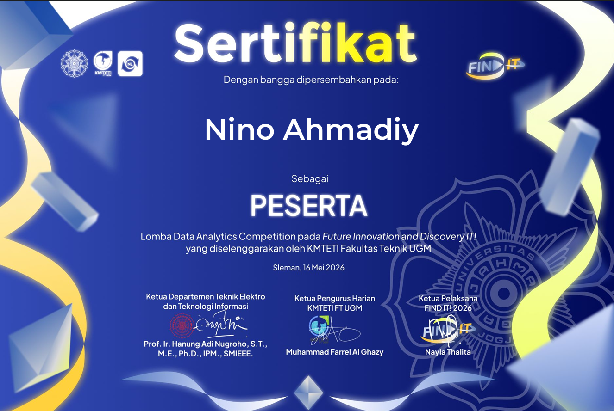

# FINDIT 2025 | Klasifikasi Wajah dengan CNN | Tim Proyek 2026 Bahagia




Notebook eksperimen untuk lomba FINDIT 2025 yang mengklasifikasikan citra wajah ke dalam enam kelas: wajah manusia asli dan lima kategori wajah palsu. Pendekatan yang digunakan adalah transfer learning dengan **ResNet50** dan **EfficientNet-V2-S**, kemudian menggabungkan probabilitas kedua model untuk menghasilkan prediksi submission.

Implementasi utama tersedia di [`CNN_P2B_FINDIT_submission().ipynb`](CNN_P2B_FINDIT_submission%28%29.ipynb).

## Data

Label kelas mengikuti nama folder yang dibaca melalui `torchvision.datasets.ImageFolder`:

| Label | Kategori |
| --- | --- |
| `fake_mannequin` | Wajah manekin |
| `fake_mask` | Wajah dengan topeng |
| `fake_printed` | Wajah pada media cetak |
| `fake_screen` | Wajah pada layar |
| `fake_unknown` | Wajah palsu kategori lainnya |
| `realperson` | Wajah manusia asli |

Output notebook mencatat **1.652 sampel latih**, pembagian **1.321 sampel training dan 331 sampel validation**, serta **404 prediksi submission**. Angka ini berasal dari output tersimpan, belum diperiksa ulang terhadap dataset mentah.

Struktur input yang diharapkan di dalam direktori `BASE_PATH`:

```text
train/
├── fake_mannequin/
├── fake_mask/
├── fake_printed/
├── fake_screen/
├── fake_unknown/
└── realperson/
test/
samplesubmission.csv
```

Folder `test/` berisi citra dengan nama sesuai ID pada `samplesubmission.csv`. Loader mendukung ekstensi `.jpg`, `.jpeg`, dan `.png`. Kolom pertama CSV digunakan sebagai ID saat memuat citra; proses penyusunan submission juga mengakses kolom bernama `id`.

## Metode

1. Mengubah ukuran citra menjadi **224 × 224 piksel** dan menerapkan normalisasi ImageNet.
2. Menggunakan `RandomHorizontalFlip` dan `ColorJitter(0.2, 0.2)` pada transformasi data latih.
3. Melatih ResNet50 dan EfficientNet-V2-S dengan bobot awal `IMAGENET1K_V1` serta mengganti layer klasifikasi menjadi enam keluaran.
4. Melakukan random search sebanyak **tiga percobaan untuk ResNet50** pada subset training, dengan accuracy validation sebagai dasar pemilihan parameter.
5. Melatih ulang kedua model final pada seluruh data latih.
6. Menghitung rata-rata probabilitas softmax kedua model dengan bobot sama, lalu memilih kelas dengan probabilitas tertinggi.

### Konfigurasi default

| Parameter | Nilai |
| --- | --- |
| Ukuran citra | `224 × 224` |
| Batch size | `32` |
| Epoch | `10` |
| Learning rate | `1e-4` |
| Optimizer | `AdamW` |
| Weight decay | `1e-4` |
| Loss | `CrossEntropyLoss` |
| Label smoothing | `0.1` |
| Device | CUDA jika tersedia, selain itu CPU |

Training menggunakan automatic mixed precision melalui `torch.cuda.amp`. Konfigurasi final ResNet50 mengikuti parameter terbaik hasil tuning jika `RUN_HYPERPARAMETER_TUNING` aktif; EfficientNet-V2-S memakai konfigurasi default.

## Menjalankan Notebook

Notebook menggunakan Google Colab dan Google Drive.

1. Buka `CNN_P2B_FINDIT_submission().ipynb` di Google Colab dan aktifkan runtime GPU untuk training.
2. Siapkan dataset di Google Drive sesuai struktur input di atas.
3. Pastikan paket berikut tersedia di lingkungan notebook:

   ```python
   %pip install torch torchvision pandas pillow numpy tqdm matplotlib scikit-learn seaborn
   ```

4. Sesuaikan `BASE_PATH` dengan lokasi dataset dan `model_dir` dengan direktori penyimpanan model di Google Drive. `TRAIN_DIR`, `TEST_DIR`, dan `SAMPLE_SUB` dibentuk dari `BASE_PATH`.
5. Jalankan sel secara berurutan, mulai dari pemasangan Google Drive hingga pembuatan submission dan evaluasi. Random search aktif secara default melalui `RUN_HYPERPARAMETER_TUNING = True`.
6. Ambil CSV submission dari direktori kerja notebook dan checkpoint dari `model_dir`.

Metadata notebook mencatat Python `3.12.12`, sedangkan output eksekusi mencatat device `cuda`. Versi paket tidak dikunci, sehingga lingkungan eksperimen belum dapat direproduksi secara persis.

## Hasil Eksperimen dan Batas Evaluasi

Accuracy validation terbaik ResNet50 selama random search yang tercatat di notebook adalah **`0.9335`**, dengan konfigurasi:

| Parameter | Nilai |
| --- | --- |
| Batch size | `32` |
| Learning rate | `5e-5` |
| Epoch | `5` |
| Optimizer | `AdamW` |
| Label smoothing | `0.05` |

Hasil tersebut berasal dari satu random split sekitar 80:20, bukan cross-validation atau skor leaderboard. Mean dan standar deviasi CV tidak tersedia. Seed belum diatur dan split belum memakai stratifikasi. Subset validation juga memakai transformasi augmentasi acak yang sama dengan training, sehingga hasil evaluasi dapat berubah antar-eksekusi.

**Evaluasi model final tidak independen:** kedua model final dilatih pada seluruh `train_ds`, termasuk sampel dalam `val_subset`, lalu dievaluasi kembali pada subset tersebut. Karena itu, accuracy final `0.9970` yang muncul di output notebook tidak digunakan sebagai bukti kemampuan generalisasi. Evaluasi ensemble pada data validation terpisah belum tersedia.

Seluruh hasil di atas merupakan catatan output notebook dan belum direproduksi ulang. Metrik resmi lomba, skor leaderboard, serta peringkat belum terverifikasi.

## Berkas Keluaran

| Berkas | Lokasi | Isi |
| --- | --- | --- |
| `resnet50_final_model.pth` | `model_dir` | Bobot ResNet50 final |
| `efficientnet_v2_s_final_model.pth` | `model_dir` | Bobot EfficientNet-V2-S final |
| `idx_to_class.pkl` | `model_dir` | Pemetaan indeks ke label kelas |
| `best_params_resnet.pkl` | `model_dir` | Parameter terbaik ResNet50, jika tuning aktif |
| `proyek_2026_bahagia_submission_final.csv` | Direktori kerja notebook | Prediksi dengan kolom `id` dan `label` |

Urutan ID pada submission mengikuti `samplesubmission.csv`. Nama CSV di atas mengikuti kode notebook; tahun lomba yang didokumentasikan adalah **2025**.
